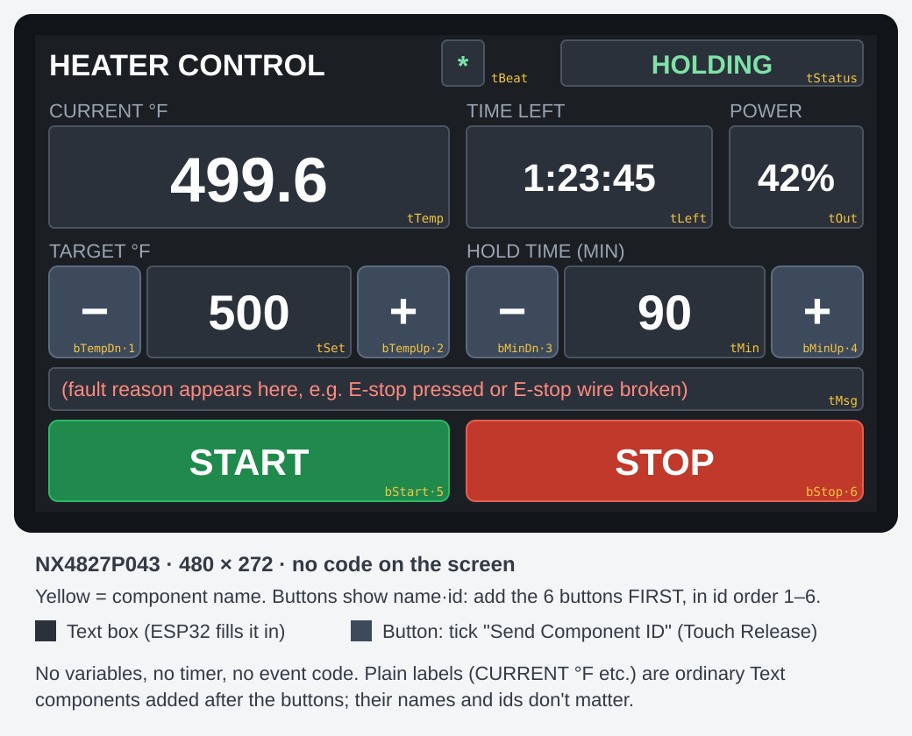

# Nextion Screen Setup: ESP32, No-Code Version

How to build the touch screen for `heater_controller_esp32.ino` on a
**Nextion NX4827P043** (4.3", 480 × 272, capacitive touch).

**There is no code to write on the screen.** You place the items, name them,
and tick one box on each button. The ESP32 handles everything else.

## How the screen and ESP32 talk

| Direction | What happens | How errors are handled |
|---|---|---|
| Button tapped → ESP32 | The screen sends its built-in "button released" message: `65 00 <id> 00 FF FF FF` | The ESP32 only accepts a message with exactly the right length and type. A garbled message is dropped, so it can never be mistaken for a different button. If a tap is lost, the number on screen doesn't change, so you can see it and tap again. |
| ESP32 → screen | Every second, the ESP32 sends all the text boxes their values | The ESP32 is the only source of what the screen shows, so the screen always shows the settings actually in use. A corrupted update is fixed a second later. |
| Link check | The ESP32 sends `sendme` every second, and the screen replies on its own | During a run, if the screen stops replying for 5 seconds, the ESP32 latches the heaters off (FAULT: screen link lost). On the screen, the `*` next to the title blinks while the link works and freezes if it's lost. |
| Screen restarts | The screen sends its startup message `88 FF FF FF` | The ESP32 sets it up again and redraws everything immediately. |

## 1. Create the project

1. Install the latest [Nextion Editor](https://nextion.tech/nextion-editor/).
2. **File → New** and save the project, e.g. `heater_esp32.HMI`.
3. In the **Device** window, pick the **Intelligent** series, then
   **NX4827P043**. Under **Display**, choose **horizontal** (480 × 272).
4. **Fonts:** open **Tools → Font Generator** and make three fonts, clicking
   **Generate font** for each and adding it to the project:

   | Font id | Height | Used for |
   |---|---|---|
   | 0 | 16 | Labels, `tStatus`, `tMsg` |
   | 1 | 32 | Buttons, `tSet`, `tMin`, `tLeft`, `tOut` |
   | 2 | 56 | `tTemp` (the big current temperature) |

   Keep the default **iso-8859-1** encoding so the ° symbol is included.

5. Click page0, and set its background colour `bco` to **6372** (dark grey).

## 2. Add the six buttons FIRST, in this exact order

The ESP32 recognises each button by its **id**. Nextion Editor assigns ids
in the order items are added (the page itself is 0), so adding the buttons
first, in this order, makes their ids 1 to 6.

For each button:
1. Add a **Button** from the Toolbox.
2. Set its `objname`, `x`, `y`, `w`, `h` and `txt` from the table.
3. Open the **Touch Release Event** tab and tick **Send Component ID**.
   Leave it **unticked** under Touch Press Event.

| Order → id | `objname` | x | y | w | h | `txt` | `bco` (colour) |
|---|---|---|---|---|---|---|---|
| 1 | `bTempDn` | 8 | 132 | 52 | 52 | `-` | 14923 |
| 2 | `bTempUp` | 184 | 132 | 52 | 52 | `+` | 14923 |
| 3 | `bMinDn` | 246 | 132 | 52 | 52 | `-` | 14923 |
| 4 | `bMinUp` | 420 | 132 | 52 | 52 | `+` | 14923 |
| 5 | `bStart` | 8 | 220 | 228 | 46 | `START` | 7241 (green) |
| 6 | `bStop` | 246 | 220 | 226 | 46 | `STOP` | 49605 (red) |

For all six, set `font` = 1 and `pco` (text colour) = 65535 (white).

**Check:** click each button and look at its `id` attribute. It should be 1–6
as in the table. If any differ, either delete and re-add the buttons in
order, or change the `ID_...` numbers near the top of the ESP32 sketch to match.

## 3. Add the text boxes the ESP32 fills in

Add a **Text** component for each. The names must match **exactly**
(case-sensitive), because the ESP32 writes to them by name. Set `txt_maxl`
large enough or the text gets cut off. Set `xcen` = Center and
`ycen` = Center for neat alignment.

| `objname` | x | y | w | h | `font` | `txt_maxl` | `bco` | `pco` | Shows |
|---|---|---|---|---|---|---|---|---|---|
| `tStatus` | 300 | 3 | 172 | 26 | 0 | 10 | 10631 | 32533 | IDLE / HEATING / HOLDING / DONE / FAULT |
| `tBeat` | 232 | 3 | 24 | 26 | 0 | 2 | 10631 | 32533 | Blinking `*` while the link works |
| `tTemp` | 8 | 52 | 228 | 58 | 2 | 10 | 10631 | 65535 | Current temperature |
| `tLeft` | 246 | 52 | 140 | 58 | 1 | 10 | 10631 | 65535 | Hold time left, H:MM:SS |
| `tOut` | 396 | 52 | 76 | 58 | 1 | 6 | 10631 | 65535 | Heater power % |
| `tSet` | 64 | 132 | 116 | 52 | 1 | 6 | 10631 | 65535 | Target temperature |
| `tMin` | 302 | 132 | 114 | 52 | 1 | 6 | 10631 | 65535 | Hold time in minutes |
| `tMsg` | 8 | 190 | 464 | 24 | 0 | 60 | 10631 | 64592 | Fault reason (blank when OK) |

Leave their `txt` empty. The ESP32 fills them in within a second of starting.

## 4. Add the plain labels

These are ordinary **Text** components with fixed wording. Their names and
ids don't matter. Use `font` = 0, `bco` = 6372 and `pco` = 40246 (light grey).

| `txt` | x | y | w | h |
|---|---|---|---|---|
| `HEATER CONTROL` (`pco` 65535) | 8 | 3 | 220 | 26 |
| `CURRENT °F` | 8 | 34 | 228 | 16 |
| `TIME LEFT` | 246 | 34 | 140 | 16 |
| `POWER` | 396 | 34 | 76 | 16 |
| `TARGET °F` | 8 | 114 | 228 | 16 |
| `HOLD TIME (MIN)` | 246 | 114 | 226 | 16 |

If ° shows as a box, the font is missing it. Regenerate the font with
iso-8859-1 encoding, or just write `F`.

That's the whole screen: **no variables, no timer, and no event code.**

## 5. Load it onto the screen

1. Click **Compile**. There should be 0 errors.
2. **File → TFT file output**, and save the `.tft` file.
3. Copy only that `.tft` file onto an empty **FAT32 microSD card**
   (32 GB or smaller).
4. With the screen powered off, insert the card, then power it on. Wait for
   the update to finish, power off, remove the card, and power on again.

Alternatively, use a 5 V USB-to-serial adapter and the editor's **Upload** button.

## 6. Wire and test

Wiring (see the README's ESP32 section for everything else):

| Nextion wire | ESP32 |
|---|---|
| Blue (TX) | GPIO16 |
| Yellow (RX) | GPIO17 |
| Black (GND) | GND, shared with the 5 V supply's GND |
| Red (5V) | Separate 5 V supply (≥1 A) |

### First: the link test sketch

Before the full controller, upload `nextion_test_esp32/nextion_test_esp32.ino`.
It only talks to the screen and never touches the relays. Open the Serial
Monitor at **115200** baud:

- `tTemp` on the screen counts up every second, `tStatus` shows **TEST**, and
  the `*` blinks. This means ESP32 → screen works and the names match.
- Every 10 s it prints `link check: ... OK`. This means screen → ESP32 works.
- Tap each button. You should see `TOUCH ... RELEASED -> bTempDn`, `-> bTempUp`
  and so on, with the right name for each button. A wrong name means the
  button order or ids are off.
- `INVALID VARIABLE` means one of `tTemp`, `tStatus` or `tBeat` is misnamed.

### Then: the full controller

Upload `heater_controller_esp32.ino`. With the **heaters unplugged**, power
everything up, open the Arduino Serial Monitor at 9600 baud and check:

1. Within a second, the screen shows the room temperature, **IDLE**, 500 and
   60, and the `*` starts blinking.
2. **+ / −** change the target in 5 °F steps and the hold time in 5-minute
   steps (15 above 2 hours).
3. **Start:** status changes to **HEATING** and the relays click on.
4. **Stop:** status returns to **IDLE** and the relays click off.
5. **Link loss:** press Start, then unplug the screen's blue wire. Within
   5 seconds the relays turn off and the Serial Monitor shows
   `FAULT: screen link lost`. Plug it back in and reset the ESP32 to clear it.
6. **E-stop:** press Start, then press the E-stop. The relays turn off at
   once and `tMsg` shows the reason.
7. Type `?` in the Serial Monitor. `BadFrames` should stay at or near 0
   (a few at power-up are normal).

### Troubleshooting

| What you see | Cause and fix |
|---|---|
| Serial Monitor: `Touch from unknown component id 7` (or another number) | Button ids don't match. Check each button's `id` in Nextion Editor, then fix the order or the `ID_...` numbers in the sketch. |
| Serial Monitor: `Touch PRESS ignored` | "Send Component ID" is ticked under Touch **Press**. Untick it there and tick it under Touch **Release**. |
| Buttons do nothing and no messages appear | Blue/yellow wires swapped, no shared GND, or "Send Component ID" not ticked. |
| Screen stays blank or shows old values; `*` doesn't blink | ESP32 → screen wire (yellow to GPIO17) or GND problem, or a text box name doesn't match exactly. |
| Some text is cut off | Increase that text box's `txt_maxl`. |
| `Can't start: no link to the screen` | The screen isn't replying to `sendme`. Check the blue wire to GPIO16 and the baud rate (both 9600). |
